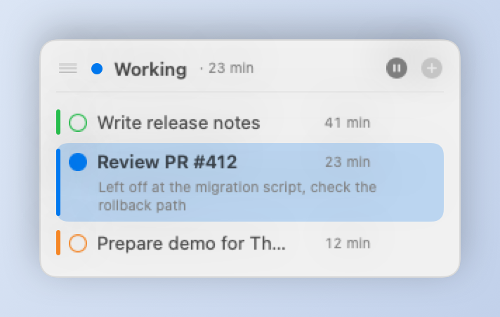
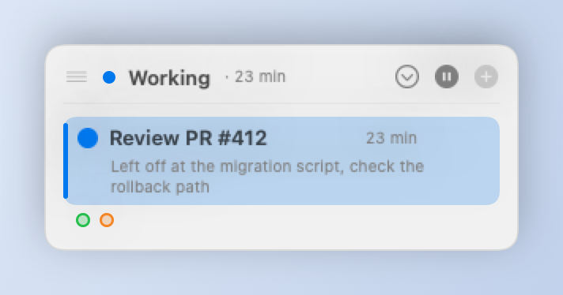
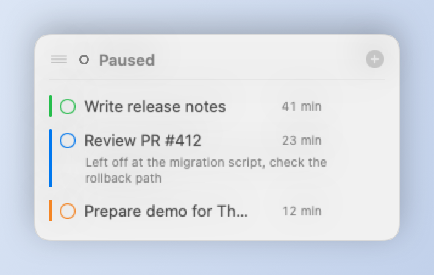
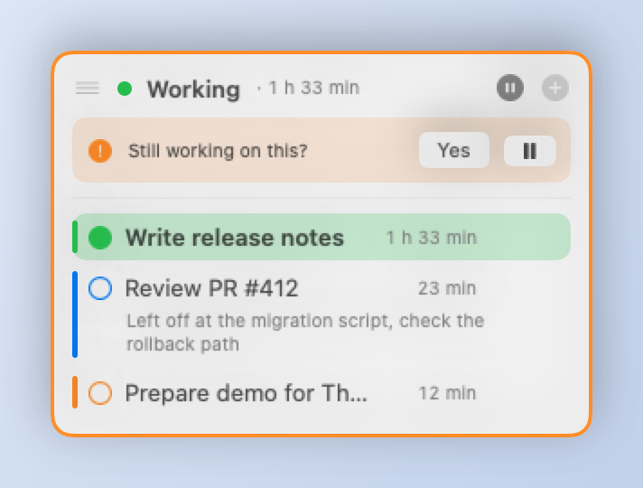

# My Focus

A small macOS app: an always-on-top window that shows what you are working on right now.
Several focuses, switching between them, time per focus, a "where did I leave off" note, a switch log,
an inactivity nudge and optional Do Not Disturb while a focus runs.

Swift + SwiftUI/AppKit, no Xcode. Edit in VS Code, build with a script.

Repo: https://github.com/rokbedenik/MyFocus

## Screenshots

<p>
  <picture>
    <source media="(prefers-color-scheme: dark)" srcset="docs/screenshots/panel-running-dark.png">
    
  </picture>
  <picture>
    <source media="(prefers-color-scheme: dark)" srcset="docs/screenshots/panel-collapsed-dark.png">
    
  </picture>
</p>
<p>
  <picture>
    <source media="(prefers-color-scheme: dark)" srcset="docs/screenshots/panel-paused-dark.png">
    
  </picture>
  <picture>
    <source media="(prefers-color-scheme: dark)" srcset="docs/screenshots/panel-nudge-dark.png">
    
  </picture>
</p>

Left to right, top to bottom: a running focus with the full list; the collapsed view while the mouse is away
(other focuses as colored dots); paused; the inactivity nudge. The images follow your GitHub theme (light/dark)
and are rendered from sample data with `scripts/make-screenshots.sh`.

## What it does

- Always-on-top panel that never steals keyboard focus; drag it anywhere, it remembers its place per display setup.
- Up to N focuses at once (default 3), one running; click to switch, the time per focus is tracked.
- "Where did I leave off" note per focus, shown when you come back to it.
- Collapses to the active focus while the mouse is away; a click shows the rest.
- Inactivity nudge ("still working on this?"), pause on screen lock/sleep, resume on unlock.
- Optional Do Not Disturb while a focus runs, calendar-based suggestions, iCloud/any-folder sync for a second Mac.
- Templates for recurring focuses, global shortcuts, undo, a daily switch log, English/Slovenian.
- No account, no network, no telemetry: one JSON file in Application Support (or your sync folder).

## Requirements

- macOS 14 (Sonoma) or newer, Apple Silicon (the prebuilt app is arm64 only; an Intel build needs
  `-target x86_64-apple-macosx14.0` in `scripts/build-app.sh`).
- For building: Xcode Command Line Tools. No Xcode, no SwiftPM.

## Install (prebuilt)

A ready-to-run build is in the repo: [`release/MyFocus.zip`](release/MyFocus.zip) (Apple Silicon, macOS 14+).

1. Download and unzip; drag `MyFocus.app` into `/Applications`.
2. The app is ad-hoc signed (no Apple developer account), so on the first launch of a *downloaded* copy macOS
   will refuse it. Either right-click → Open → Open, or clear the quarantine flag once:
   ```sh
   xattr -dr com.apple.quarantine /Applications/MyFocus.app
   ```
3. Launch it from Spotlight or Launchpad as "My Focus". It lives in the menu bar (no Dock icon). For autostart,
   enable "Launch at login" in the menu bar menu.

## Build from source

Requirements: macOS 14+, Xcode Command Line Tools (`xcode-select --install`). No Xcode, no SwiftPM build.

```sh
scripts/build-app.sh            # release build -> build.noindex/dist/MyFocus.app
scripts/build-app.sh debug      # debug build (-Onone -g)
scripts/build-app.sh install    # build, replace /Applications/MyFocus.app, relaunch
scripts/build-app.sh release    # build + refresh release/MyFocus.zip
```

The script compiles `Sources/MyFocus/*.swift` with `swiftc`, assembles the `.app` bundle, copies the icon and
`Info.plist`, and ad-hoc signs it. Output goes to `build.noindex/` so Spotlight does not list the build copy next
to the installed app.

Note: the Command Line Tools currently ship SDK 27.0, which the bundled compiler cannot read (version mismatch).
The script therefore defaults to SDK 26.5. Once Apple fixes the CLT you can remove that part of
`scripts/build-app.sh` (or set `SDKROOT` yourself).

## Development workflow

1. Open the folder in VS Code with the **Swift** extension (swiftlang.swift-vscode); `Package.swift` is there so the
   extension gives you completion and inline errors. Because of the SDK 27.0 mismatch (see above) SourceKit may show
   bogus errors such as "plugin for module 'SwiftUIMacros' not found"; point it at the working SDK in
   `.vscode/settings.json`:
   ```json
   {
     "swift.buildArguments": ["--sdk", "/Library/Developer/CommandLineTools/SDKs/MacOSX26.5.sdk"],
     "swift.sourcekit-lsp.serverArguments": ["-Xswiftc", "-sdk", "-Xswiftc", "/Library/Developer/CommandLineTools/SDKs/MacOSX26.5.sdk"]
   }
   ```
   The build script is unaffected either way.
2. Edit code under `Sources/MyFocus/`.
3. `scripts/build-app.sh install` – compiles, replaces the installed app and relaunches it. Compile errors are
   printed; nothing is replaced if the build fails.
4. When you want to ship the result: `scripts/build-app.sh release`, then commit `release/MyFocus.zip` with the code.

Optional VS Code task (`.vscode/tasks.json`) so ⌘⇧B does step 3:

```json
{
  "version": "2.0.0",
  "tasks": [
    {
      "label": "Build & install My Focus",
      "type": "shell",
      "command": "scripts/build-app.sh install",
      "group": { "kind": "build", "isDefault": true },
      "problemMatcher": []
    }
  ]
}
```

## Usage

- The window stays on top, on all Spaces, and never steals focus. Drag it by the handle (≡) in the header.
  Its height follows the number of focuses. The position is remembered across launches; the default is the
  top-left corner. Hide and show it with ⌃⌥F or from the menu bar.
- The header shows the state: a colored dot + "Working · 12 min", or "Paused". The ⏸ button (shown while a
  focus runs) pauses, **+** adds a focus (type, Enter; Esc cancels). At most 3 focuses by default, configurable 1–50 in Settings.
- Each focus has its own color (assigned automatically, change it via right-click → Color).
- While the mouse is away the panel shows only the active focus (or the last active one while paused); the other
  focuses shrink to colored dots that you can click to switch. Clicking the row or the chevron in the header shows
  all rows; they fold away again once the mouse leaves (Settings → Behavior → Window to turn this off). Buttons
  react to the first click even when another app is active. The window is anchored at its top edge and grows
  downward, so the header with the drag handle and the + button never moves. Click a row to switch, the active one
  has a tinted background. Double-click the name (or right-click → Rename) to rename it.
- Hovering a row shows 💬 (note: where did I leave off) and ✓ (done: removes the focus from the list, its time stays
  in the log). Right-click offers the same plus Rename, Color, Save as template and Delete. Delete/done can be
  undone from the menu bar.
- **Templates** (Settings → Templates): reusable focuses with a name and color. When you press + they appear as chips
  above the text field; one click creates the focus, or switches to it if one with that name is already open. Also in
  the menu under "New from template". Right-click any focus → "Save as template" to create one.
- **Global shortcuts** (Settings → Shortcuts): show/hide window (default ⌃⌥F), new focus (off by default) and
  note on the active focus (off by default). Click the field, press the combination; ⌫ turns it off.
- **Size** (Settings → Appearance): a slider from 80 % to 200 % scales the whole panel (text, icons, spacing, width).
- **Calendar** (off by default): when a calendar event starts, the panel shows "Starting now: <title>" with
  Switch / Dismiss. Switch reuses a focus with the same title or creates one. Declined and all-day events are
  ignored; macOS asks for calendar access once.
- **Multiple displays**: the window position is remembered per display arrangement, so docking/undocking a
  laptop puts it back where it was on that setup.
- **Sync** (off by default): keeps `state.json` in a folder of your choice (default `iCloud Drive/MyFocus`) so a
  second Mac can use the same focuses. Each Mac notices the other's writes within 30 s. Last writer wins; do not run
  a focus on both Macs at once. For iCloud Drive keep the folder downloaded (no "Optimize Mac Storage" eviction).
- **Inactivity nudge**: after N minutes on the same focus (default 45, 0 = off) the window border turns orange and asks
  "Still working on this?" with Yes / ⏸.
- **Idle dimming**: while paused, the window fades after N seconds without the mouse over it (default 10, 0 = never)
  and comes back on a click (hovering leaves it dimmed), when a focus starts, or when a nudge is due. A running
  focus is never dimmed.
- **Do Not Disturb** (off by default): while a focus runs, DND is on; it goes off on pause, screen lock, sleep and
  quit. See below for the one-time setup.
- Locking the screen or sleeping pauses; unlocking resumes the last focus.
- **Log** (menu bar → Log …, ⌘L) opens a window with today's switches; the text is selectable and there is a Copy button.
- The menu bar item shows the current focus and offers switching, pause, undo (delete/done), log, settings, show/hide
  and launch at login.
- Language: English or Slovenian, in Settings (defaults to the system language).
- Data: `~/Library/Application Support/MyFocus/state.json` (or the sync folder); settings in UserDefaults
  (`com.rbedenik.myfocus`).

### Do Not Disturb setup

macOS has no public API for Focus modes, so the app runs two shortcuts through the `shortcuts` command line tool.
The CLI cannot *create* shortcuts, but it can sign and import prepared ones. One-time setup:

```sh
scripts/make-dnd-shortcuts.sh
```

This writes the two `.shortcut` files with the "Set Focus" action pre-configured, signs them and opens them;
Shortcuts shows an import dialog for each — click **Add Shortcut**. Check with `shortcuts list | grep "MyFocus DND"`.

If you prefer to build them by hand, create them in the **Shortcuts** app (Settings → Do Not Disturb →
"Open Shortcuts"):

| Shortcut name (exact) | Action |
|---|---|
| `MyFocus DND On`  | Set Focus → Do Not Disturb → **On** (until turned off) |
| `MyFocus DND Off` | Set Focus → Do Not Disturb → **Off** |

Then enable "Turn on Do Not Disturb while a focus is running" in Settings. The first run may ask you to allow
My Focus to run shortcuts. Failures are logged to the system log (`log stream --predicate 'process == "MyFocus"'`).

## Uninstall

Quit the app from the menu bar, then remove:

```sh
rm -rf /Applications/MyFocus.app
rm -rf ~/Library/Application\ Support/MyFocus          # focuses, log, templates
defaults delete com.rbedenik.myfocus                    # settings, window position
```

If "Launch at login" was on, it disappears from System Settings → General → Login Items together with the app.
The two DND shortcuts (if you created them) stay in the Shortcuts app; delete them there.

## Troubleshooting

| Symptom | Cause / fix |
|---|---|
| "MyFocus is damaged" or "cannot be opened" on first launch | Quarantine flag on the downloaded zip: `xattr -dr com.apple.quarantine /Applications/MyFocus.app`, or right-click → Open. |
| DND does not switch | Check `shortcuts list \| grep "MyFocus DND"`; the names must match exactly. Run `shortcuts run "MyFocus DND On"` in Terminal once to grant permissions. |
| Calendar suggestions never appear | Calendar access was denied: System Settings → Privacy & Security → Calendars → My Focus. Declined and all-day events are ignored. |
| Global shortcut does nothing | Another app owns the combination; pick a different one in Settings → Shortcuts. |
| Window is off-screen after changing displays | Position is per display arrangement; `defaults delete com.rbedenik.myfocus panelPositions` resets it to the top-left corner. |
| Second Mac shows old data | Sync folder not downloaded (iCloud "Optimize Mac Storage"), or both Macs ran a focus at once (last writer wins). |
| Build: "unable to load standard library" / SDK errors | SDK 27.0 mismatch; the script picks SDK 26.5 automatically, or set `SDKROOT`. |

## Data and privacy

Everything stays on your Mac. `state.json` (focuses, times, notes, log, templates) lives in
`~/Library/Application Support/MyFocus/` or in the sync folder you chose; settings and the window position are in
`defaults` under `com.rbedenik.myfocus`. The app makes no network requests. Calendar access is only requested when
you enable the calendar feature.

## Layout

```
Package.swift                 SwiftPM manifest (for the VS Code Swift extension only)
Sources/MyFocus/
  main.swift                  entry point, AppDelegate, menu bar, hotkey, lock/sleep observers
  FloatingPanel.swift         NSPanel (floating, non-activating, auto-sized, top-anchored, position memory, idle dimming)
  PanelView.swift             SwiftUI content of the panel
  FocusStore.swift            state, switching, timing, undo, nudge, JSON persistence
  Model.swift                 Focus, SwitchEvent, AppState, color palette
  AppSettings.swift           settings (UserDefaults)
  SettingsView.swift          settings window
  LogWindow.swift             log window
  DoNotDisturb.swift          DND on/off via Shortcuts
  CalendarWatcher.swift       EventKit polling, focus suggestion when an event starts
  L10n.swift                  string table (en/sl)
  DragHandle.swift            window drag handle
  HotKey.swift                KeyShortcut model + HotKeyCenter (Carbon global shortcuts)
  ShortcutRecorder.swift      "press keys" control used in Settings
Resources/Info.plist          bundle metadata (LSUIElement = no Dock icon)
Resources/AppIcon.icns        app icon (generated, committed)
release/MyFocus.zip           prebuilt app (refresh with scripts/build-app.sh release)
scripts/build-app.sh          build + package .app + ad-hoc sign (+ install / release)
scripts/make-icon.swift       regenerates AppIcon.icns from the "scope" SF Symbol
scripts/make-dnd-shortcuts.sh creates + imports the two DND shortcuts
scripts/make-screenshots.sh   renders docs/screenshots/*.png from sample data (no window needed)
scripts/make-screenshots.swift  the renderer, compiled together with the app sources
docs/screenshots/             README images (light + dark)
```

## Screenshots (regenerating)

`scripts/make-screenshots.sh` compiles the app sources with a small `@main` that builds sample data in a scratch
folder (`MYFOCUS_STATE_DIR`), hosts `PanelView` in an `NSHostingView` and draws it into a 2x PNG, for the light
and the dark appearance. Nothing is shown on screen, so it also works from CI or a sandbox. Run it after UI
changes and commit the images.

## App icon

`Resources/AppIcon.icns` is generated and committed. To change it, edit `scripts/make-icon.swift` and run:

```sh
swiftc -sdk /Library/Developer/CommandLineTools/SDKs/MacOSX26.5.sdk scripts/make-icon.swift -o /tmp/make-icon \
  && /tmp/make-icon Resources/AppIcon.icns
```

macOS caches icons aggressively; after replacing the app in `/Applications` you may need to run
`killall Finder Dock` or log out to see the new icon.

## Ideas for later

- Weekly report: time per focus, number of switches per day, longest uninterrupted stretch
- Keyboard switching: ⌃⌥1 … ⌃⌥5 jump straight to the n-th focus
- Pomodoro mode: optional 25/5 cycle on the active focus with the nudge bar as the break prompt
- Export: today's/this week's log as CSV or Markdown for a timesheet
- Interruption counter: a quick "I got interrupted" button that logs the moment without switching
- Calendar: pick which calendars count, and end the focus when the event ends
- Sync: proper merge instead of last-writer-wins
